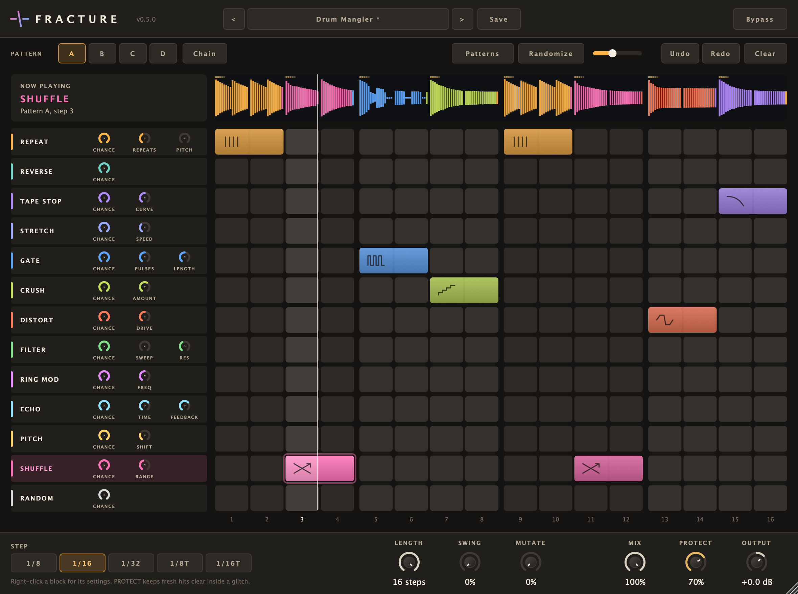

# Fracture

**A step sequencer of glitch effects.** Draw effect blocks onto a 16-step grid and Fracture plays them in time
with your DAW: stutters, reverses, tape stops, time-stretches, gates, bit crushing, distortion, filter sweeps, ring
modulation, echoes, pitch shifts and shuffled slices. Pick a preset, hit Randomize, turn up Mutate and let
the pattern evolve, or play effects live from a MIDI keyboard. 370+ presets to start from.

AU · VST3 · Standalone — macOS (Windows VST3 builds in CI) — by [Rhizr](https://rhizr.dev/music), built with [JUCE](https://juce.com)



## Features

- **Thirteen effect lanes**: Repeat, Reverse, Tape Stop, Stretch, Gate, Crush, Distort, Filter, Ring Mod, Echo,
  Pitch, Shuffle — and Random, which plays a different effect each time
- **Blocks** — an effect can last one step or many; drag across the grid to draw one, drag it to move it, drag
  its edge to resize it
- **Per-block settings** — right-click a block to give it its own chance and value (e.g. 8 repeats here,
  16 there, or a pitch that steps down block by block)
- **Four patterns (A–D) and Chain**; **Mutate** lets the pattern evolve a little every loop
- **Presets** — 50+ of our own in categories (Stutter, Time, Rhythm, Lo-Fi, Filter & Space, Pitch,
  Random & Evolving, Combos), a **Glitch 2 Library** of 320+ patterns converted from the Glitch 2 factory banks
  (designers credited in [CREDITS.md](CREDITS.md)), plus your own saved as `.fracturepreset` files
- **MIDI** — notes C1–D#1 switch between patterns A–D; notes from C2 up play an effect live for as long as they're
  held, even with the transport stopped
- **Timing** — 1/8, 1/16, 1/32 or triplet steps, swing, and pattern lengths of 1–16 for polyrhythms
- **Live view** — a waveform of the output coloured by the effect that shaped each moment, a playhead, and a
  sweep across the block that's playing
- **Undo/redo**, resizable window, mix, output and click-free bypass

## Install

### Download

Get the latest zip for your system from [Releases](https://github.com/matiasconcha11/fracture/releases/latest).

**macOS** — unzip and move the plugin into place:
- AU (Logic, GarageBand): `Fracture.component` → `~/Library/Audio/Plug-Ins/Components/`
- VST3 (Ableton, Reaper, etc.): `Fracture.vst3` → `~/Library/Audio/Plug-Ins/VST3/`

The builds aren't notarized by Apple yet, so macOS blocks them at first. Clear the download flag in Terminal:
```
xattr -dr com.apple.quarantine ~/Library/Audio/Plug-Ins/Components/Fracture.component ~/Library/Audio/Plug-Ins/VST3/Fracture.vst3
```
Then restart your DAW and look for **Rhizr → Fracture**.

**Windows** — unzip and move `Fracture.vst3` into `C:\Program Files\Common Files\VST3\`. (The Windows build is
compiled and unit-tested automatically but hasn't been tried in a DAW yet.)

### Build from source

1. Install Xcode (or its Command Line Tools) and the build tools:
   ```
   xcode-select --install
   brew install cmake ninja
   ```
2. Build:
   ```
   git clone https://github.com/matiasconcha11/fracture.git
   cd fracture
   make
   ```

The build installs the plugin into `~/Library/Audio/Plug-Ins/`.

## Using it

- Drag across empty steps in a lane to draw a block; click a block to delete it, drag it to move it, drag its
  right edge to make it longer or shorter. Right-click a block for its own chance and value.
- A step holds one effect at a time: drawing over a step replaces whatever was there.
- In Logic, route MIDI to Fracture with the **Side Chain** (MIDI) menu at the top of the plugin window.
- Hover a small knob to see what it does; drag it to change the value.
- Effects that replay audio (Repeat, Reverse, Tape Stop, Shuffle) use what the track played a moment ago, so they
  work best on parts that are already playing (drums, loops, vocals), not on the very first step after you press play.

## Development

```
make            # Release build, installed into ~/Library/Audio/Plug-Ins/
make test       # unit tests (Catch2)
make validate   # pluginval at strictness 10 on the VST3 and AU
make check      # test + validate

./build/FractureTests "[.snapshot]"   # render the editor to /tmp/fracture.png
```

CI builds and tests on macOS and Windows on every push; pushing a version tag builds release zips.

## Status

Fracture is young: it passes pluginval and Apple's auval, and real-world testing in Logic Pro is under way.
Bug reports and ideas are welcome in [Issues](https://github.com/matiasconcha11/fracture/issues).

More from [Rhizr](https://rhizr.dev/music): **[Contour](https://github.com/matiasconcha11/contour)** (curve shaper) and
**[Duck](https://github.com/matiasconcha11/duck)** (one-knob sidechain).

## License

Fracture is free software under the [GNU Affero General Public License v3.0](LICENSE): you can use, study, change
and share it, as long as anything you distribute that's built on it is released under the same license.
It's built on [JUCE](https://juce.com), which is used here under the same AGPLv3 terms.
